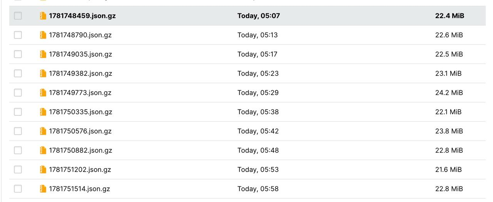

**TL;DR:** I could not tell who used which bucket on our MinIO cluster. I
pointed MinIO's audit webhook at one Vector pod, flattened each event in
VRL, and wrote it to ClickHouse for per-request analytics, to Prometheus as
counters for live dashboards, and to a gzipped archive that ClickHouse can
read back to fill gaps.

## Background

I ran the on-prem data platform of a large company: Spark, Airflow, dbt and
ClickHouse on RKE2 Kubernetes, deployed with Argo CD, serving about 45
analytics teams. Its storage was a 16-server, 192-drive MinIO cluster
with about 500 TB usable, and hundreds of access keys: people, service
accounts, and short-lived STS credentials for every Spark job.

## Issue

MinIO exports Prometheus metrics per node and per bucket, so I could see
that a bucket was busy. I could not see **who** made the requests, which
access keys were still in use, or which client made the slow calls.
`mc admin trace` shows calls live, but keeps nothing to query later.

MinIO answers it in its audit log: one JSON event per request, with the
API name, bucket, object, status code, bytes in and out, latency and the
access key. MinIO can push these events to an HTTP endpoint, the audit
webhook. What I needed was a place to send them where I could run SQL over
a few months of them.

## The pipeline

Every MinIO server pushes its audit events to one Vector pod. Vector turns
each event into a flat record and sends it three ways: to ClickHouse for
analytics, to Prometheus as counters, and to a gzipped archive in MinIO.
The diagram shows the flow; the dashed edge is the backfill path from the
archive back into ClickHouse.



It ran on Vector 0.58, ClickHouse 24.10 and MinIO RELEASE.2025-03-12.
Vector came from the official Helm chart as a stateless aggregator:
**one replica with 2 CPU and 2 GiB of RAM requested** handled the audit
traffic of all 16 servers (the limits were 4 CPU and 8 GiB).

### MinIO: the audit webhook

MinIO reads the webhook from environment variables, suffixed with a
target name of your choice. My MinIO Helm chart rendered them into the
server pods whenever the Vector component was on:

```yaml
env:
  - {name: MINIO_AUDIT_WEBHOOK_ENABLE_vector, value: "on"}
  - {name: MINIO_AUDIT_WEBHOOK_ENDPOINT_vector, value: "http://minio-vector.my-namespace.svc:8282/audit"}
  - {name: MINIO_AUDIT_WEBHOOK_QUEUE_SIZE_vector, value: "128"}
```

The endpoint is the Kubernetes Service of the Vector pod. I set the queue
to 128 events; the default is 100,000. It matters when Vector is down; see
[What it does not do](#what-it-does-not-do).

### Vector: flatten every event

The source is a plain HTTP server that parses the body as JSON:

```yaml
sources:
  minio_webhook:
    type: http_server
    address: 0.0.0.0:8282
    path: /audit
    method: POST
    decoding: {codec: json}
```

A raw audit event is nested: `api.name`, `api.statusCode`,
`tags.objectLocation.poolId`, and full request and response headers. The
remap builds a new, flat object and **copies only the fields a query
needs**. Everything else, including the headers, is dropped by the last
line, `. = event`.

```yaml
transforms:
  flatten:
    type: remap
    inputs: [minio_webhook]
    source: |-
      event = {}
      event.api = .api.name
      if event.api == null || event.api == "" { event.api = "Unknown" }
      event.bucket = .api.bucket
      if .api.object != null && .api.object != "" { event.object = .api.object }
      event.timestamp = parse_timestamp(.time, format: "%+") ?? now()
      event.unixMillis = to_unix_timestamp(event.timestamp, "milliseconds")

      if .api.statusCode != null {
        event.accessKey = .accessKey
        event.userAgent = .userAgent
        event.requestID = .requestID
        event.status = .api.statusCode
        if .api.rx != null { event.rx = to_int!(.api.rx) }
        if .api.tx != null { event.tx = to_int!(.api.tx) }
        event.timeToResponseInNS = parse_int(.api.timeToResponseInNS) ?? 0
        if .tags.objectLocation != null {
          event.poolId = .tags.objectLocation.poolId
          event.setId = .tags.objectLocation.setId
        }
      }
      . = event
```

Events without a status code come from MinIO itself (the scanner, healing,
lifecycle), so they get no access key or traffic fields. The real remap
also expands multi-object deletes into an `objects` array, keeps a few
forwarded headers and clamps negative byte counts, which I left out here.

Dropping the headers has a second benefit. MinIO copies request headers
into the event as they are, so a raw event carries the `Authorization`
header with the SigV4 signature. The flat records keep the access key ID
and nothing else from the credentials.

### ClickHouse: one flat table

Each field of the flat record is a column. Bucket, API name and access
key repeat millions of times with few distinct values, so they are
`LowCardinality`:

```sql
CREATE TABLE minio_audit_events
(
    timestamp          DateTime,
    unixMillis         UInt64,
    api                LowCardinality(String),
    bucket             LowCardinality(String),
    object             Nullable(String),
    objects            Array(String),
    accessKey          LowCardinality(Nullable(String)),
    userAgent          Nullable(String),
    requestID          Nullable(String),
    status             Nullable(UInt16),
    rx                 Nullable(UInt32),
    tx                 Nullable(UInt32),
    timeToResponseInNS Nullable(UInt64),
    poolId             Nullable(UInt8),
    setId              Nullable(UInt8)
)
ENGINE = MergeTree
PARTITION BY toYYYYMMDD(timestamp)
ORDER BY timestamp
TTL timestamp + INTERVAL 2 MONTH;
```

I left out five identity and request-path columns. Partitions are daily
and rows expire after two months. Two months of events took **about 300 GB
compressed**.

The Vector sink sends JSON rows over HTTP. `skip_unknown_fields` lets the
remap emit a field before the table has a column for it:

```yaml
sinks:
  clickhouse:
    type: clickhouse
    inputs: [flatten]
    endpoint: https://clickhouse.example.com
    auth: {strategy: basic, user: vector, password: SECRET[k8s.CH_PASSWORD]}
    database: default
    table: minio_audit_events
    format: json_each_row
    skip_unknown_fields: true
    encoding: {timestamp_format: unix}
    batch: {max_bytes: 268435456, max_events: 200000, timeout_secs: 600}
```

`SECRET[k8s.CH_PASSWORD]` reads the password from a file mounted from a
Kubernetes Secret, set up in Vector's `secret` block, which I left out.

Every insert into a MergeTree table creates a new part on disk, and many
small inserts mean many small parts for the background merges to catch
up with. Vector waits for 200,000 events, 256 MiB or 10 minutes,
whichever comes first, so **ClickHouse gets a few large inserts per
hour** instead of hundreds of small ones.

### The archive, and backfill from it

The same flat records go to an `audit-events` bucket as gzipped JSON
lines, one prefix per day:

```yaml
sinks:
  archive:
    type: aws_s3
    inputs: [flatten]
    endpoint: http://minio.my-namespace.svc:9000
    region: us-east-1
    auth: {access_key_id: SECRET[k8s.AWS_ACCESS_KEY_ID], secret_access_key: SECRET[k8s.AWS_SECRET_ACCESS_KEY]}
    bucket: audit-events
    key_prefix: "year=%Y/month=%m/day=%d/"
    filename_extension: json.gz
    filename_append_uuid: false
    compression: gzip
    encoding: {codec: json}
    framing: {method: newline_delimited}
    batch: {max_bytes: 1073741824, max_events: 800000, timeout_secs: 3600}
```

A file landed about every 5 minutes, at about 22 MiB:



Beside it, a separate prefix held the raw events, three to four times
larger. I never needed them for analytics.

With the archive, I could drop and rebuild the ClickHouse table, or
change its schema, without losing history. An `S3` table engine reads
the files in place, with the same columns as the main table:

```sql
CREATE TABLE minio_audit_events_ext AS minio_audit_events
ENGINE = S3(
    'http://minio.my-namespace.svc:9000/audit-events/year=2024/month=12/day=*/*.json.gz',
    'ACCESS_KEY', 'SECRET_KEY', 'JSONEachRow', 'gzip');
```

The glob reads one month; a small script generated the table for the
days I needed. After a ClickHouse outage, one `INSERT ... SELECT` loads
everything newer than the last row ClickHouse has:

```sql
INSERT INTO minio_audit_events
SELECT * FROM minio_audit_events_ext
WHERE unixMillis > (SELECT max(unixMillis) FROM minio_audit_events)
SETTINGS date_time_input_format = 'best_effort';
```

Vector writes `timestamp` into the archive as an RFC 3339 string with
nanoseconds, which the default `DateTime` parser rejects; `best_effort`
reads it. My real query sidestepped it with
`toDateTime(unixMillis / 1000)`.

The `max(unixMillis)` watermark only works because one Vector replica
wrote the archive: one queue, one sequence of files. That is why I kept a
single replica instead of two; see the HA note below.

To check the lag between the archive and ClickHouse:

```sql
SELECT formatReadableTimeDelta(
    (SELECT max(unixMillis) FROM minio_audit_events_ext) / 1000
  - (SELECT max(unixMillis) FROM minio_audit_events) / 1000) AS lag;
```

ClickHouse gets data every 10 minutes at most and the archive up to every
hour, so the lag is often negative, which is fine. A large positive value
means ClickHouse is missing data.

### Prometheus: counters for live dashboards

For live panels and alerts, Vector also turns each event into counters with `log_to_metric`, and a
`prometheus_exporter` sink exposes them for scraping:

```yaml
transforms:
  client_events:
    type: filter
    inputs: [flatten]
    condition: '.status != null && .status != ""'
  audit_metrics:
    type: log_to_metric
    inputs: [client_events]
    metrics:
      - {type: counter, field: api, namespace: vector_minio, name: actions_total,
         tags: {bucket: "{{ bucket }}", api: "{{ api }}", status: "{{ status }}"}}
      - {type: counter, field: tx, namespace: vector_minio, name: tx_total, increment_by_value: true,
         tags: {bucket: "{{ bucket }}", api: "{{ api }}", status: "{{ status }}"}}
sinks:
  prometheus:
    type: prometheus_exporter
    inputs: [audit_metrics]
    address: 0.0.0.0:2222
```

The filter skips MinIO's own events, which have no status or byte
counts. The real config also counts `rx_total` and a latency histogram,
and counts the internal events separately. Labels
must stay low-cardinality: bucket, API name and status are fine, an object
key would blow up Prometheus. Requests per bucket is then one line:

```promql
sum by (bucket) (rate(vector_minio_actions_total[5m]))
```

## The dashboards

The Grafana dashboards answered three questions: who uses which data,
where the bottlenecks are, and which access keys are alive. The queries
below are written for this post against the table above, in the same
shape as the dashboard panels.

Who reads and writes which bucket:

```sql
SELECT accessKey, bucket, count() AS requests
FROM minio_audit_events
WHERE timestamp > now() - INTERVAL 1 DAY
GROUP BY accessKey, bucket
ORDER BY requests DESC
LIMIT 20;
```

Slow APIs, by 95th percentile latency:

```sql
SELECT api,
       count() AS requests,
       round(quantile(0.95)(timeToResponseInNS) / 1e6) AS p95_ms
FROM minio_audit_events
WHERE timestamp > now() - INTERVAL 1 DAY AND status IS NOT NULL
GROUP BY api
ORDER BY p95_ms DESC;
```

Errors per API and status code:

```sql
SELECT api, status, count() AS errors
FROM minio_audit_events
WHERE timestamp > now() - INTERVAL 1 DAY AND status >= 400
GROUP BY api, status
ORDER BY errors DESC;
```

Traffic per access key, and when each key was last seen. A key that has
been quiet for weeks is a candidate for removal:

```sql
SELECT accessKey,
       formatReadableSize(sum(rx)) AS received,
       formatReadableSize(sum(tx)) AS sent,
       max(timestamp) AS last_seen
FROM minio_audit_events
WHERE accessKey IS NOT NULL
GROUP BY accessKey
ORDER BY last_seen;
```

## What I would change in the table

I did not run any of this; it is what I would try first.


These are recommendations from AI-assisted research against the ClickHouse
docs, not changes I made or measured in production.


- Sort by what queries filter on. With `ORDER BY timestamp` alone, a
  per-bucket query reads every granule in the time range.
  `ORDER BY (bucket, api, timestamp)` puts low-cardinality keys first, as
  the ClickHouse docs advise for log tables. Daily partitions still prune
  by time. `EXPLAIN indexes = 1` before and after shows how many granules
  a query skips.
- Use `UInt64` for `rx` and `tx`. A `UInt32` wraps silently above 4 GiB,
  so one large object upload skews the traffic totals.
- Drop `Nullable`. Each `Nullable` column stores a separate null mask, and
  empty strings and zeros say the same thing for these fields.
- Keep one time column: `DateTime64(3)` replaces both `timestamp` and
  `unixMillis`.
- Try `CODEC(ZSTD(3))` on `object` and `userAgent`, the largest columns.
- Set `ttl_only_drop_parts = 1`, so expiry drops whole daily parts
  instead of rewriting them.

The dashboards scan raw rows, billions of them over two months. **An
hourly rollup** would let most panels read a few thousand rows instead.
A materialized view fills it on every insert:

```sql
CREATE TABLE minio_audit_hourly
(
    hour      DateTime,
    bucket    LowCardinality(String),
    api       LowCardinality(String),
    accessKey LowCardinality(String),
    requests  SimpleAggregateFunction(sum, UInt64),
    tx        SimpleAggregateFunction(sum, UInt64),
    p95       AggregateFunction(quantile(0.95), UInt64)
)
ENGINE = AggregatingMergeTree
ORDER BY (bucket, api, accessKey, hour);

CREATE MATERIALIZED VIEW minio_audit_hourly_mv TO minio_audit_hourly AS
SELECT toStartOfHour(timestamp) AS hour, bucket, api,
       ifNull(accessKey, '') AS accessKey,
       count() AS requests,
       sum(ifNull(tx, 0)) AS tx,
       quantileState(0.95)(ifNull(timeToResponseInNS, 0)) AS p95
FROM minio_audit_events
GROUP BY hour, bucket, api, accessKey;
```

Panels then read it with `sum(requests)` and `quantileMerge(0.95)(p95)`.
The view only sees new inserts, so older days need one
`INSERT INTO minio_audit_hourly SELECT ...` with the same query.

## A note on high availability

One Vector replica is a single point of failure, and I accepted that for
**ordering**: one queue keeps the archive a single sequence of files, and
the backfill watermark stays correct. Two replicas behind one Service
would split events between two independent batch streams with overlapping
time ranges.

If I needed HA, I would run independent copies of the stream rather than
load balance one stream. MinIO accepts several audit webhook targets, so
two Vector pods could each get every event and write their own archive
prefix. Vector's HA guide adds disk buffers and end-to-end
acknowledgements, so a restart does not lose what is in memory. The two
copies then need deduplication in ClickHouse, for example on
`requestID`. I have not run this.

## What it does not do

- MinIO drops events when Vector is down. With no `QUEUE_DIR`, the webhook
  queue lives in memory, and I had set it to 128 events. When it is full,
  MinIO logs "log buffer full" and drops the event. Set
  `MINIO_AUDIT_WEBHOOK_QUEUE_DIR_<name>` to a local path to queue on disk
  and replay later.
- A long ClickHouse outage reaches MinIO too. Vector's buffers block when
  full, so a stuck sink slows the HTTP source, and then the webhook queue
  fills up.
- The watermark backfill only refills a gap at the end. A batch lost in
  the middle, followed by successful inserts, stays missing. Reloading a
  whole day (`ALTER TABLE ... DROP PARTITION`, then an insert filtered to
  that day) covers it.
- No global order across servers. Events arrive in the order Vector
  receives them, and queries sort by `timestamp`.
- The raw archive holds request headers, including SigV4 signatures. A
  header signature is only accepted for about 15 minutes, but that prefix
  still deserves a tight bucket policy.
- MinIO itself is archived. The community repository has been read-only
  since April 2026. [pgsty/silo](https://github.com/pgsty/silo) is a
  maintained AGPL fork that keeps the `MINIO_*` environment variables, so
  the webhook config above should carry over. I have not run it.

## Conclusion

- MinIO's audit webhook says **who did what** to which bucket, which its
  own Prometheus metrics do not.
- Flatten events in Vector: keep only the fields you query, and the
  headers and signatures never reach storage.
- One Vector pod with 2 CPU and 2 GiB requested handled 16 MinIO servers,
  and ClickHouse kept two months of events in about 300 GB.
- Keep a gzipped archive next to the table: an `S3` table engine and one
  `INSERT ... SELECT` refill ClickHouse after an outage.
- Batch on the client: Vector's 200,000-event batches give ClickHouse a
  few large parts per hour, so merges keep up without extra machinery.

## Links

- [MinIO: audit and server logging](https://github.com/minio/minio/blob/master/docs/logging/README.md)
- [Silo: MinIO server settings, metrics and logging](https://silo.pgsty.com/reference/minio-server/settings/metrics-and-logging/)
- [pgsty/silo on GitHub](https://github.com/pgsty/silo)
- [Vector: http_server source](https://vector.dev/docs/reference/configuration/sources/http_server/)
- [Vector: remap transform and VRL](https://vector.dev/docs/reference/configuration/transforms/remap/)
- [Vector: clickhouse sink](https://vector.dev/docs/reference/configuration/sinks/clickhouse/)
- [Vector: aws_s3 sink](https://vector.dev/docs/reference/configuration/sinks/aws_s3/)
- [Vector: log_to_metric transform](https://vector.dev/docs/reference/configuration/transforms/log_to_metric/)
- [Vector: high availability](https://vector.dev/docs/setup/going-to-prod/high-availability/)
- [ClickHouse: S3 table engine](https://clickhouse.com/docs/engines/table-engines/integrations/s3)
- [ClickHouse: schema design for observability](https://clickhouse.com/docs/use-cases/observability/schema-design)
- [ClickHouse: selecting data types](https://clickhouse.com/docs/best-practices/select-data-types)
- [ClickHouse: AggregatingMergeTree](https://clickhouse.com/docs/engines/table-engines/mergetree-family/aggregatingmergetree)
